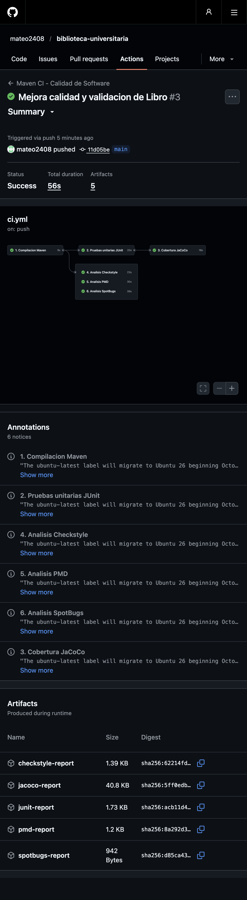

# Biblioteca Universitaria

Proyecto Java/Maven utilizado para demostrar el uso de pruebas unitarias y
herramientas de calidad de software.

## Enlaces

- [Repositorio actualizado](https://github.com/mateo2408/biblioteca-universitaria)
- [Ejecución final de GitHub Actions](https://github.com/mateo2408/biblioteca-universitaria/actions/runs/44222936477)
- [Archivo principal: Libro.java](src/main/java/Libro.java)
- [Pruebas unitarias: LibroTest.java](src/test/java/LibroTest.java)

Si el repositorio es privado, debe concederse acceso al docente
`guillermo.avila@udla.edu.ec`.

## Presentación de resultados

### Mejoras implementadas

1. **Validación de datos en el constructor:** se añadió validación para
   rechazar títulos y autores `null`, vacíos o compuestos solo por espacios.
   Esto evita crear objetos de `Libro` con información inválida.
2. **Ampliación de las pruebas unitarias:** se añadieron casos para títulos y
   autores nulos o vacíos, y para comparar un título con `null`.
3. **Corrección SpotBugs:** se declaró `Libro` como `final` para eliminar la
   advertencia `CT_CONSTRUCTOR_THROW`, que detecta riesgos asociados a
   excepciones lanzadas desde constructores.

### Evidencia del pipeline

La ejecución final terminó con estado **Success** y los seis jobs mostraron
estado verde:

1. Compilación Maven.
2. Pruebas unitarias JUnit.
3. Cobertura JaCoCo.
4. Análisis Checkstyle.
5. Análisis PMD.
6. Análisis SpotBugs.

Captura correspondiente a la ejecución
[44222936477](https://github.com/mateo2408/biblioteca-universitaria/actions/runs/44222936477).

### Análisis de calidad antes y después

| Herramienta | Resultado inicial | Mejora o análisis | Resultado final |
|---|---|---|---|
| JaCoCo | 7 pruebas; 48 instrucciones cubiertas, 2 ramas cubiertas, 15 líneas cubiertas y 7 métodos cubiertos. Cobertura de clase: 100% para las métricas registradas. | Se añadieron 3 pruebas para datos inválidos y comparación con `null`, aumentando las rutas ejecutadas. | 10 pruebas; 62 instrucciones cubiertas, 4 ramas cubiertas, 19 líneas cubiertas y 8 métodos cubiertos. Cobertura de clase: 100% para las métricas registradas. |
| Checkstyle | Se registraron 30 advertencias en la clase inicial: Javadoc ausente e indentación conforme a Google Java Format. | Se incorporaron Javadoc, documentación de parámetros/excepciones y formato compatible con las reglas Google. | 0 advertencias restantes. |
| PMD | No se identificaron problemas en el reporte inicial. | Se mantuvo una implementación sencilla y se añadieron validaciones sin introducir reglas adicionales incumplidas. | 0 problemas identificados. |
| SpotBugs | El reporte inicial no registró defectos. Al introducir validaciones adicionales en el constructor apareció `CT_CONSTRUCTOR_THROW`. | Se corrigió haciendo la clase `Libro` final, como recomienda la mitigación contra ataques de finalizer. | 0 defectos restantes. |

La cobertura no descendió porque las mejoras ampliaron las pruebas que ejercitan
las validaciones nuevas y permanecieron cubiertas todas las rutas existentes.
Checkstyle cambió de 30 advertencias a cero y SpotBugs pasó de una advertencia
detectada durante el ciclo de mejoras a cero defectos finales.

## Conclusiones

La revisión mostró que una construcción compilada no siempre implica calidad:
es necesario combinar pruebas unitarias, cobertura y análisis estático. Las
mejoras agregaron validaciones realistas para datos inválidos y aumentaron la
prueba de ramas relevantes, pasando de 7 a 10 pruebas sin afectar
comportamientos válidos. La corrección de SpotBugs reforzó la seguridad del
modelo al impedir la creación de una subclase vulnerable. Finalmente, el
pipeline confirmó que compilación, pruebas, cobertura y los tres analizadores
pueden funcionar juntos y terminar correctamente con JDK 21.